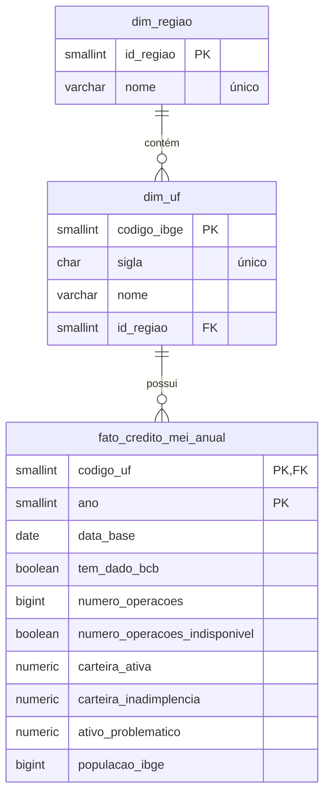

# Crédito MEI por UF — Big Data e Analytics


**Disciplina:** Big Data e Analytics
**Instituição:** UCSAL
**Integrantes:** Lian Santana, Tauan Gramacho e Vitor Senhorinho

**Objetivo do projeto:** analisar a evolução do crédito concedido a Microempreendedores Individuais (MEI) nas unidades federativas do Brasil entre 2020 e 2025, relacionando volume de crédito, inadimplência e população._

---

## Sumário

1. [Visão geral do fluxo](#1-visão-geral-do-fluxo)
2. [Dados utilizados](#2-dados-utilizados)
3. [Tratamento realizado](#3-tratamento-realizado)
4. [Modelagem](#4-modelagem)
5. [Infraestrutura](#5-infraestrutura)
6. [Segurança das informações](#6-segurança-das-informações)
7. [Execução](#7-execução)
8. [Estrutura do repositório](#8-estrutura-do-repositório)

---

## 1. Visão geral do fluxo

```
Dados públicos (BCB + IBGE)
        ↓
Tratamento e agregação (ETL)          → etl/
        ↓
Modelagem dimensional (esquema estrela) → sql/schema.sql
        ↓
Carga no PostgreSQL na nuvem (Aiven)   → provisionado em infra/ (Terraform)
        ↓
View analítica com indicadores         → vw_credito_mei_indicadores
```

---

## 2. Dados utilizados

### Fonte dos dados

| Fonte | Conteúdo | Uso no projeto |
|---|---|---|
| **Banco Central do Brasil (BCB)**: nome exato da base e link_ | Operações de crédito a MEI por UF | Carteira ativa, inadimplência, ativo problemático |
| **IBGE** estimativas populacionais | População residente por UF | Normalização dos indicadores (crédito por habitante) |


### Recorte utilizado

- **Período:** 2020 a 2025 (5 anos)
- **Abrangência:** 27 unidades federativas
- **Granularidade final:** 1 registro por UF por ano
- **Data-base:** 31 de dezembro de cada ano

### Características relevantes da base

- A base original do BCB é composta por microdados de grande volume; a versão final ocupa **cerca de 8 MB** no banco, muito abaixo do limite de 1 GB do plano gratuito da Aiven.
- **Todos os 162 registros possuem dados do BCB** (nenhuma UF/ano sem informação).
- **O número de operações está indisponível em 100% dos registros.** A coluna foi mantida, com uma flag explicando a ausência, para preservar a estrutura da fonte e deixar explícito que o dado falta na origem e não foi perdido no tratamento.
- Há forte concentração da carteira na Região Nordeste (cerca de 74% do total no período).

---

## 3. Tratamento realizado

#TODO; @TauanGramacho

### Principais problemas identificados

- Volume dos microdados incompatível com o limite de armazenamento do banco (1 GB).
- Valores monetários em formato texto na origem, exigindo conversão para tipo numérico exato.
- Ausência do número de operações na fonte.
- Necessidade de cruzar bases de órgãos diferentes (BCB e IBGE) por uma chave comum.

### Decisões e transformações

| Decisão | Transformação | Justificativa |
|---|---|---|
| **Agregação prévia** | Microdados resumidos para 1 linha por UF por ano | Reduz o volume a 162 registros (~8 MB) e atende à granularidade necessária para a análise |
| **Recorte temporal** | Apenas 2020–2025 |
| **Data-base anual** | Padronizada como 31/12 de cada ano | Representa a posição da carteira no fechamento do ano |
| **Chave por código IBGE** | UFs identificadas pelo código IBGE (ex.: 29 = BA) | Permite o cruzamento direto entre BCB e IBGE sem depender de nomes |
| **Tipagem monetária** | Valores convertidos para `numeric(20,2)` | Decimal exato, sem erros de arredondamento de ponto flutuante |
| **Tratamento de ausentes** | `numero_operacoes` mantido como nulo + flag `numero_operacoes_indisponivel` | Não inventar nem descartar dados; deixar a ausência explícita |
| **Validações no banco** | Restrições `CHECK` (ver seção 4) | Garantem a qualidade dos dados mesmo em cargas futuras |

### Versões tratada

- **Versão tratada:** `data/tratada/` (um CSV por tabela, idêntico ao conteúdo carregado no banco)

---

## 4. Modelagem

### Estratégia

Foi adotado um **modelo dimensional em esquema estrela** (na forma de floco de neve, pois a dimensão de UF se relaciona com a de região). A escolha se justifica porque:

- os dados são **analíticos** (medidas numéricas observadas ao longo do tempo e do território), o caso de uso típico do modelo dimensional;
- separar dimensões evita repetir nomes de estados e regiões em todas as linhas da fato;
- facilita agregações por região, UF e ano nas próximas fases do projeto.

Os indicadores derivados ficam em uma **view**, e não em colunas gravadas, para não duplicar dados e sempre refletir o conteúdo atual da tabela fato.

### Diagrama



### Tabelas, campos e tipos

**`dim_regiao`** — 5 registros

| Campo | Tipo | Descrição |
|---|---|---|
| `id_regiao` | smallint (PK) | Identificador da região |
| `nome` | varchar(20), único | Nome da região |

**`dim_uf`** — 27 registros

| Campo | Tipo | Descrição |
|---|---|---|
| `codigo_ibge` | smallint (PK) | Código IBGE da UF |
| `sigla` | char(2), único | Sigla da UF |
| `nome` | varchar(40) | Nome da UF |
| `id_regiao` | smallint (FK → dim_regiao) | Região da UF |

**`fato_credito_mei_anual`** — 162 registros (27 UFs × 6 anos)

| Campo | Tipo | Descrição |
|---|---|---|
| `codigo_uf` | smallint (PK, FK → dim_uf) | UF do registro |
| `ano` | smallint (PK) | Ano de referência (2020–2025) |
| `data_base` | date | Data-base do dado (31/12 do ano) |
| `tem_dado_bcb` | boolean | Indica se havia dado do BCB para a UF/ano |
| `numero_operacoes` | bigint, aceita nulo | Quantidade de operações |
| `numero_operacoes_indisponivel` | boolean | Indica ausência da contagem na fonte |
| `carteira_ativa` | numeric(20,2) | Saldo da carteira de crédito ativa |
| `carteira_inadimplencia` | numeric(20,2) | Saldo em inadimplência |
| `ativo_problematico` | numeric(20,2) | Saldo de ativos problemáticos |
| `populacao_ibge` | bigint | População estimada da UF no ano |

**`vw_credito_mei_indicadores`** (view) — junta as três tabelas e calcula:

| Indicador | Fórmula |
|---|---|
| `credito_por_habitante` | `carteira_ativa / populacao_ibge` |
| `taxa_inadimplencia_percentual` | `100 × carteira_inadimplencia / carteira_ativa` |

`NULLIF` é usado nas divisões para evitar erro de divisão por zero.

### Relacionamentos

- `dim_uf.id_regiao` → `dim_regiao.id_regiao` (N:1)
- `fato_credito_mei_anual.codigo_uf` → `dim_uf.codigo_ibge` (N:1)

As chaves estrangeiras usam `ON DELETE RESTRICT` (impede apagar uma UF ou região que tenha dados associados) e `ON UPDATE CASCADE`.

### Regras de qualidade no banco

- **Chave primária composta** `(codigo_uf, ano)`: impede registro duplicado da mesma UF no mesmo ano.
- **Ano** restrito ao intervalo 2020–2025.
- **`data_base`** obrigatoriamente igual a 31/12 do ano.
- Se `numero_operacoes_indisponivel` for verdadeiro, `numero_operacoes` deve ser nulo.
- Valores monetários e contagens não podem ser negativos.
- População deve ser maior que zero (é usada como divisor).
- Índice em `ano` para acelerar consultas filtradas por período.

O script completo de criação está em [`sql/schema.sql`](sql/schema.sql).

### Quantidade de dados armazenados

| Objeto | Registros |
|---|---|
| `dim_regiao` | 5 |
| `dim_uf` | 27 |
| `fato_credito_mei_anual` | 162 |
| **Tamanho total do banco** | **~8 MB** |

---

## 5. Infraestrutura

### Serviços utilizados

| Item | Valor |
|---|---|
| Plataforma | **Aiven** (banco de dados gerenciado) |
| Serviço | PostgreSQL 18 |
| Projeto Aiven | `ucsal-bigdata2` |
| Nome do serviço | `pg-1366b989` |
| Provedor / região | DigitalOcean — Nova York (`do-nyc`) |
| Plano | Free Tier (1 nó, limite de 1 GB) |

### Infraestrutura como código (Terraform)

A infraestrutura está descrita na pasta [`infra/`](infra/):

| Arquivo | Conteúdo |
|---|---|
| `versions.tf` | Versão do Terraform e do provider `aiven/aiven` |
| `providers.tf` | Configuração do provider (token lido de variável de ambiente) |
| `variables.tf` | Projeto, serviço, região e plano |
| `main.tf` | Recurso `aiven_pg` que representa o banco |
| `outputs.tf` | Host, porta e usuário (sem a senha) |
| `terraform.tfvars.example` | Modelo de arquivo de variáveis, sem valores reais |

O serviço foi criado inicialmente pelo console da Aiven. Para que ele passasse a ser gerenciado como código **sem ser recriado e sem perda dos dados**, foi usado o bloco `import` do Terraform, que associa o recurso existente ao código. Após o import, `terraform plan` retorna **"No changes"**, comprovando que o código representa fielmente a infraestrutura real.

O recurso possui `prevent_destroy = true`, que impede a exclusão acidental do banco por um `terraform destroy`.

### Tecnologias empregadas

- PostgreSQL 18
- Terraform (provider `aiven/aiven` 4.x)
- linguagem/ferramentas do ETL: Python, pandas
- Git / GitHub

---

## 6. Segurança das informações

Nenhuma credencial (senha do banco, token da API da Aiven) está versionada neste repositório. A estratégia adotada:

| Segredo | Onde fica | Como é usado |
|---|---|---|
| Token da API da Aiven | Variável de ambiente `TF_VAR_aiven_api_token` | Lido pelo Terraform em `providers.tf` |
| Senha do banco | Variável de ambiente `PGPASSWORD` (arquivo `.env` local) | Lida pelo ETL e por clientes SQL |

Medidas complementares:

- **`.gitignore`** bloqueia `.env`, `*.tfvars` e `*.tfstate`. O arquivo de estado do Terraform (`terraform.tfstate`) **contém a senha do banco em texto puro** e por isso nunca é versionado.
- **Arquivos de exemplo** (`.env.example`, `terraform.tfvars.example`) mostram quais variáveis são necessárias, sem os valores reais.
- O token é marcado como `sensitive` no Terraform, para não aparecer nos logs.
- Os outputs do Terraform expõem apenas host, porta e usuário, nunca a senha.
- A conexão com o banco exige **SSL** (`sslmode=require`).
- **Rotação de credenciais:** a senha do banco foi trocada após o compartilhamento durante o desenvolvimento. _(confirmar após realizar a troca)_

---

## 7. Execução

### Ferramentas e dependências

- [Git](https://git-scm.com/)
- [Terraform](https://developer.hashicorp.com/terraform/install) 1.6 ou superior
- Cliente PostgreSQL (DBeaver, pgAdmin ou `psql`)
- dependências do ETL: Python 3.x e `requirements.txt`
- Conta na Aiven com acesso ao projeto `ucsal-bigdata2` e um token de API

### Configuração das credenciais

```bash
cp .env.example .env
# edite o .env e preencha TF_VAR_aiven_api_token e PGPASSWORD
```

Para carregar as variáveis no terminal:

```bash
# Linux / Mac
export $(grep -v '^#' .env | xargs)
```

```powershell
# Windows (PowerShell)
Get-Content .env | Where-Object { $_ -and $_ -notmatch '^#' } | ForEach-Object {
    $k, $v = $_ -split '=', 2; Set-Item -Path "env:$k" -Value $v
}
```

### Sequência de execução

**1. Infraestrutura**

```bash
cd infra
terraform init      # baixa o provider da Aiven
terraform plan      # deve indicar apenas o import do serviço existente
terraform apply     # associa o banco existente ao código
terraform plan      # deve retornar "No changes"
```

**2. Estrutura do banco**

```bash
psql -f sql/schema.sql
```

O script é idempotente (`IF NOT EXISTS` / `CREATE OR REPLACE`): pode ser executado em um banco que já tenha as tabelas sem causar erro nem apagar dados.


## 8. Estrutura do repositório

```
.
├── README.md                 Documentação do projeto
├── .gitignore                Arquivos que não devem ser versionados (segredos, state)
├── .env.example              Modelo das variáveis de ambiente
├── .env (NÃO SOBE PARA O REPOSITORIO POR QUESTÕES DE SEGURANÇA)
├── data/
│   ├── original/             (a completar @TauanGramacho) Base original ou links das fontes
│   └── tratada/              Base tratada, um CSV por tabela
├── etl/                      (a completar @TauanGramacho) Código de tratamento e carga
├── sql/
│   └── schema.sql            Criação de tabelas, chaves, índice e view
└── infra/                    Terraform da infraestrutura na Aiven
    ├── versions.tf
    ├── providers.tf
    ├── variables.tf
    ├── main.tf
    ├── outputs.tf
    └── terraform.tfvars.example
```
